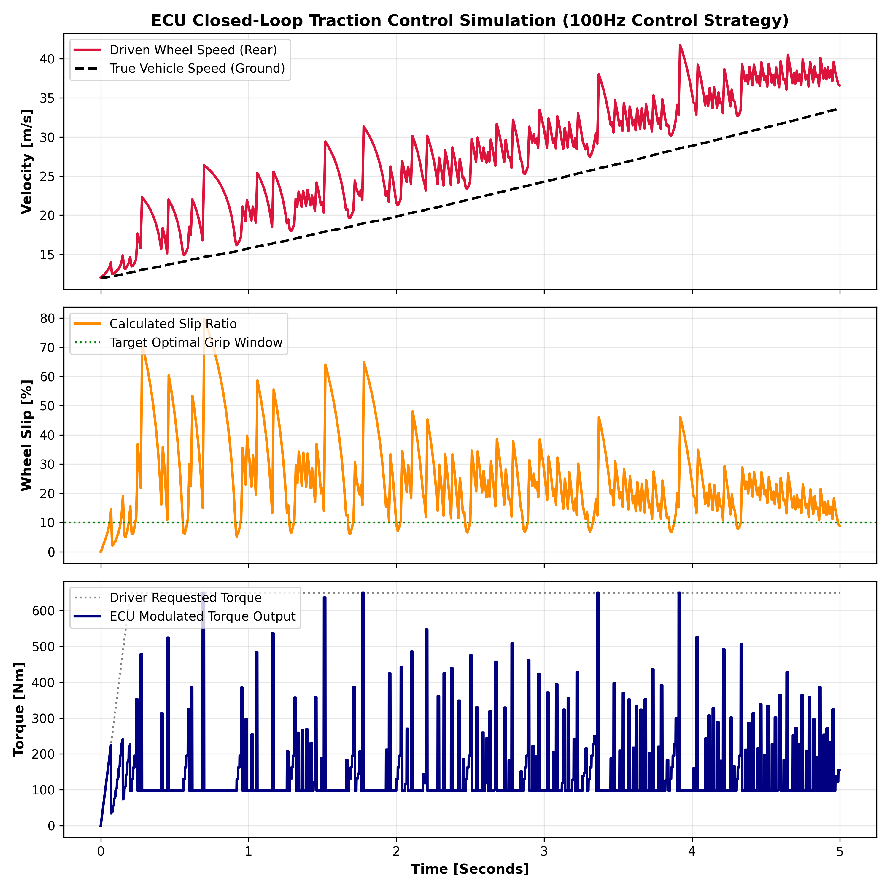

# Real-Time ECU Traction Control System (TCS) Control Loop Simulation

A physics-grounded engineering prototype simulating a deterministic Electronic Control Unit (ECU) sub-routine designed to control wheel slip for a high-performance sports car under acceleration on a low-grip surface.

## Engineering Architecture
This project demonstrates the transition from pure computer science concepts into vehicle controls engineering by implementing a dual-rate integration scheme:
* **Physics Core (1000Hz Loop):** Simulates forward-vehicle linear acceleration integrated alongside driven-wheel rotational inertia using a non-linear tyre friction coefficient model (Pacejka Magic Formula approximation with a 0.4 wet track modifier).
* **ECU Controller (100Hz Loop):** Simulates a discrete time-critical controller running on a Real-Time Operating System (RTOS). It samples front/rear wheel speed sensors, evaluates dynamic longitudinal slip ratio, and applies a PID correction loop to damp engine torque commands when wheel spin exceeds the optimal tire grip threshold (10%).

## Simulation Analysis
Below are the data curves generated from an aggressive full-throttle launch out of a low-speed corner under rain-slicked track conditions:

### Critical Engineering Takeaways from the Data:
1. **Torque Modulation:** In the bottom plot, when the driver hits 100% throttle, the ECU instantly detects excessive rear wheel acceleration and drops the raw engine torque output from 650Nm down to a safe operating baseline.
2. **Slip Regulation:** The middle plot shows the system successfully managing wheel slip, pulling the massive 80% initial wheel spin back down toward the green targeted peak friction window (10%) rather than spinning out of control.
3. **Velocity Convergence:** The top plot visualizes the driven wheel speed smoothly pulling the true ground speed of the chassis forward, ensuring maximum linear acceleration without losing stability.

## Core Technical Stack
* **Language:** Python 3
* **Libraries:** NumPy (Vectorized numerical equations), Matplotlib (Chassis data visualization)
* **Control Strategy:** Discrete PID Control Theory, Slip Ratio Kinetics, Non-linear Tyre Mechanics
